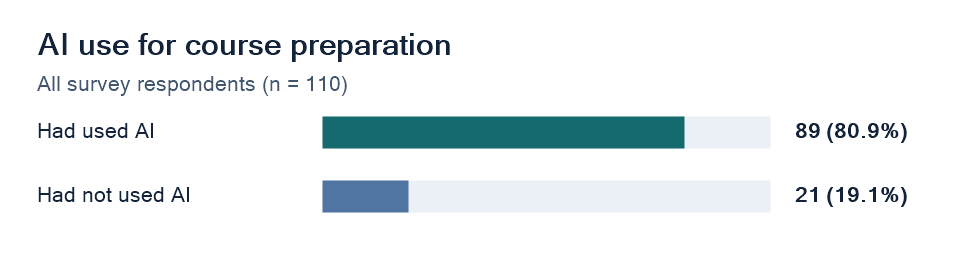
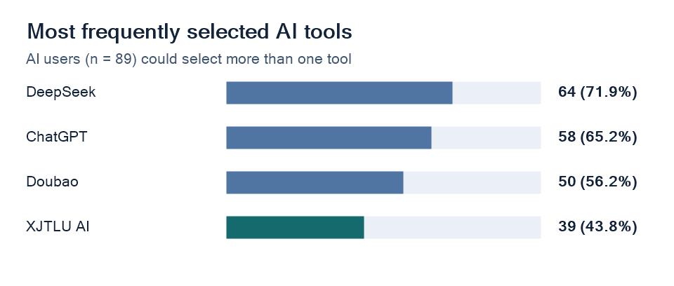
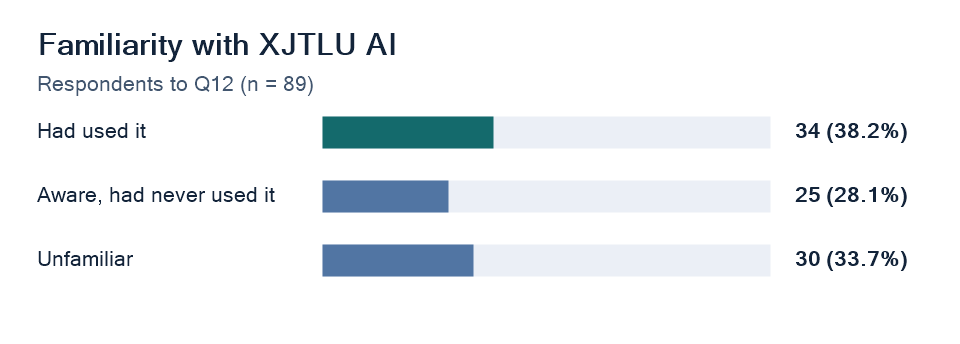

# XJTLU AI in Course Preparation

ADS401 · Group L 

## Project Topic

How does XJTLU AI compare with other tools for course preparation, and how do respondents rate their experience with it?

### AI Interface

## Target Participants

The survey targeted XJTLU postgraduate students entering in 2026. In total, 110 people responded. We could not verify the entry year of every respondent.

### Questionnaire

## Questionnaire Procedure

1. Recruit students and share the online questionnaire.
2. Ask participants to give informed consent (Q1).
3. Administer the 16-item questionnaire. If respondents answered “No” to having used AI for course preparation (Q4), they skipped Q5–Q11 and continued to Q12.
4. Collect responses online.
5. Clean the data and calculate descriptive statistics.

## Survey Results

### AI Use and Usual Tools

Of the 110 respondents, 89 (80.9%) had used AI to prepare for class and 21 (19.1%) had not. Among the 89 AI users, DeepSeek was the most frequently selected tool. XJTLU AI ranked fourth.

| Usual tool | Selections | Share of AI users |
| --- | ---: | ---: |
| DeepSeek | 64 | 71.9% |
| ChatGPT | 58 | 65.2% |
| Doubao | 50 | 56.2% |
| XJTLU AI | 39 | 43.8% |

Respondents could select more than one tool. In the question on reasons for choosing AI tools (Q8), 67 of 89 cited accuracy.

### XJTLU AI Familiarity and Ratings

In the separate familiarity question (Q12), 34 of 89 respondents said they had used XJTLU AI, 25 had heard of it but had never used it, and 30 were unfamiliar with it.

Of the 59 respondents who rated XJTLU AI (Q13), 30 (50.8%) rated it good or very good. The slides report approximately 36% neutral and 14% poor or very poor. The 59 ratings describe everyone who answered Q13. The familiarity question recorded 34 self-reported users.

### Descriptive Statistics

| Survey item | N | Mean | SD | Min | 25th percentile | Median | 75th percentile | Max |
| --- | ---: | ---: | ---: | ---: | ---: | ---: | ---: | ---: |
| Q9. Trust in AI accuracy | 89 | 3.80 | 1.00 | 1 | 3 | 4 | 4 | 5 |
| Q10. Concern about loss of independent thinking | 89 | 2.51 | 1.13 | 1 | 2 | 2 | 3 | 5 |
| Q13. XJTLU AI experience | 59 | 3.47 | 1.02 | 1 | 3 | 4 | 4 | 5 |

Ratings range from 1 to 5. Higher ratings indicate greater trust for Q9, greater concern for Q10, and a better experience for Q13.

## Study Limitations and Next Steps

| Limitation | Next step |
| --- | --- |
| We could not verify that every respondent entered XJTLU in 2026. | Ask for entry year and recruit across programmes. |
| 59 respondents rated XJTLU AI, while 34 reported prior use. | Route the experience question to respondents who confirm prior use. |

Review the detailed survey export for suggestions on improving XJTLU AI (Q14). A total of 53 of 89 respondents volunteered for a follow-up interview (Q15).

## Conclusion

XJTLU AI ranked fourth among the tools respondents selected for course preparation. Thirty of the 59 respondents who rated it gave a positive rating. Estimating use and satisfaction across the 2026 postgraduate cohort would require verified entry years, broader recruitment, and ratings from confirmed users.

## Survey Figures

*Figure 1. Use of AI for course preparation among all 110 respondents.*

*Figure 2. The four most frequently selected tools among 89 AI users. Multiple selections were allowed.*

*Figure 3. Familiarity with XJTLU AI in Q12.*
